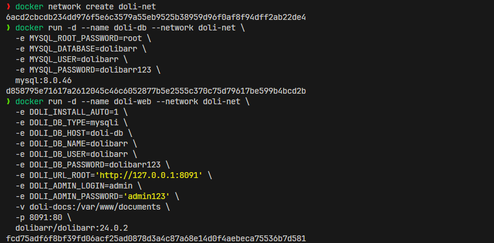
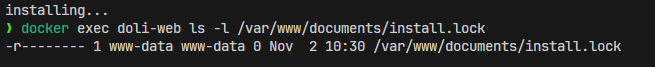
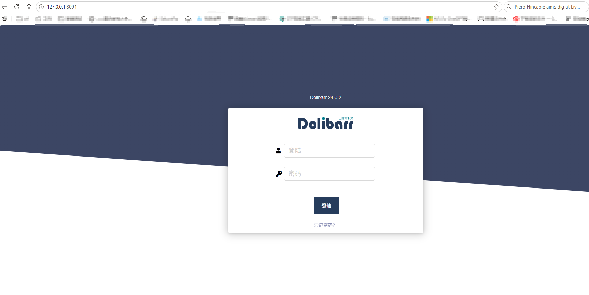

# Dolibarr 24.0.2 Reproduction Environment Setup

- Image: `dolibarr/dolibarr:24.0.2` (official image)
- Source download: [sourceforge.net/projects/dolibarr/files/Dolibarr%20ERP-CRM/24.0.2](https://sourceforge.net/projects/dolibarr/files/Dolibarr%20ERP-CRM/24.0.2/)
- Access URL: `http://127.0.0.1:8091`
- Administrator: `admin / admin123`
- Database: `mysqli`, container name `doli-db`
- Data directory: named volume `doli-docs` → `/var/www/documents` (outside the webroot)

The whole environment is the **default output of the official installer with only bundled modules enabled**, with no security hardening applied; it serves as the reproduction baseline.

---

## 1. Create the network

```bash
docker network create doli-net
```

## 2. Start the database

```bash
docker run -d --name doli-db --network doli-net \
  -e MYSQL_ROOT_PASSWORD=root \
  -e MYSQL_DATABASE=dolibarr \
  -e MYSQL_USER=dolibarr \
  -e MYSQL_PASSWORD=dolibarr123 \
  mysql:8.0.46
```

## 3. Start the web container and install automatically

```bash
docker run -d --name doli-web --network doli-net \
  -e DOLI_INSTALL_AUTO=1 \
  -e DOLI_DB_TYPE=mysqli \
  -e DOLI_DB_HOST=doli-db \
  -e DOLI_DB_NAME=dolibarr \
  -e DOLI_DB_USER=dolibarr \
  -e DOLI_DB_PASSWORD=dolibarr123 \
  -e DOLI_URL_ROOT='http://127.0.0.1:8091' \
  -e DOLI_ADMIN_LOGIN=admin \
  -e DOLI_ADMIN_PASSWORD='admin123' \
  -v doli-docs:/var/www/documents \
  -p 8091:80 \
  dolibarr/dolibarr:24.0.2
```

Notes on two parameters:


| Parameter       | Description                                                                                                                       |
| ----------------- | ------------------------------------------------------------------------------------------------------------------------------------ |
| `DOLI_URL_ROOT` | Must exactly match the URL used by the browser; an https value or a missing port causes broken login redirects                     |
| `-p 8091:80`    | Do not write `-p 127.0.0.1:8091:80`, otherwise the browser on the Windows host cannot reach it (WSL2 only forwards ports bound to 0.0.0.0) |



## 4. Wait for the installation to finish

```bash
until docker exec doli-web test -f /var/www/documents/install.lock 2>/dev/null; do
  echo "installing..."; sleep 3
done
docker exec doli-web ls -l /var/www/documents/install.lock
```



## 5. Log in

Open `http://127.0.0.1:8091` in a browser and log in with `admin / admin123`.


